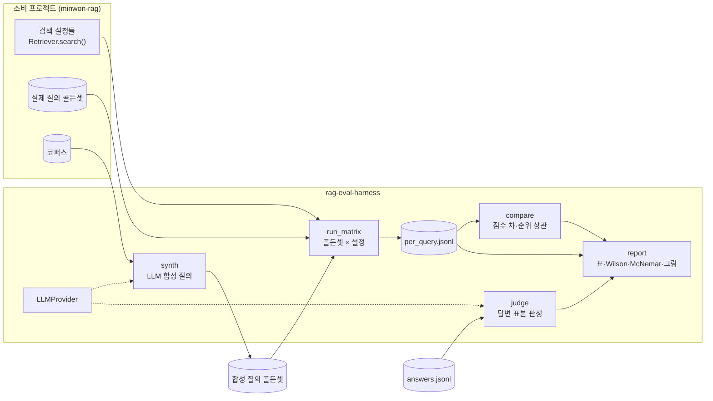

# RAG 평가 하네스

[](https://github.com/parksungyun0411/rag-eval-harness/actions/workflows/ci.yml)  [](LICENSE)

검색·RAG 평가 코드를 특정 도메인에서 떼어 낸 패키지입니다. 랭킹 지표, 설정 비교용 통계, 실험 매트릭스 실행기, 보고서 생성기를 담고 있고, [minwon-rag](https://github.com/parksungyun0411/minwon-rag)가 이 패키지를 의존성으로 씁니다.

이 저장소에는 "골든셋 2종 비교" 실험도 들어 있습니다. 같은 검색 설정들을 실제 시민 질의 골든셋과 LLM이 합성한 질의 골든셋으로 각각 재고, 점수가 얼마나 차이 나는지와 설정 순위가 얼마나 유지되는지(Kendall·Spearman 순위 상관)를 계산합니다. 합성 질의로 만든 골든셋이 점수를 부풀린다는 영어권 연구는 있지만, 한국어 실제 질의로 확인한 공개 구현은 찾지 못했습니다. 합성 골든셋이 점수를 부풀리더라도 설정 순위가 같다면 설정을 고르는 용도로는 쓸 수 있고, 순위까지 바뀐다면 합성 골든셋으로 고른 설정이 실제 질의에서는 최선이 아닐 수 있습니다.

> 현재 상태: 패키지 코드와 단위 테스트까지 완료했습니다. 실험에 필요한 공공데이터 인증키와 LLM 키를 받기 전이라 측정은 아직 하지 않았고, 아래 결과 표는 비어 있습니다.

## 구현 범위

- 랭킹 지표: hit@k, recall@k, MRR, nDCG@k, mAP — 손으로 계산한 값으로 테스트
- 통계: Wilson 점수 신뢰구간, McNemar 대응 검정(정확 이항/연속성 보정 카이제곱), Kendall tau-b·Spearman rho
- 실험 매트릭스 실행기: (골든셋 × 검색 설정) 전 조합 실행, 질의별 지표·지연 시간과 런 파일 저장
- 골든셋 비교: 설정별 점수 차, 두 골든셋에서의 설정 순위와 순위 상관, 골든셋별 최고 설정
- 보고서 생성기: 마크다운 표와 그림(recall@k 곡선, 골든셋 산점도)을 `reports/`에 생성
- LLM 공급자 인터페이스: Anthropic, OpenAI 호환 서버(로컬 vLLM·Ollama 포함)
- 합성 질의 골든셋 생성, 답변 표본 LLM 판정(근거성·정확성·유용성 1~5점, 통과율 Wilson 구간)
- `rag-eval` 명령: `synth` / `compare` / `judge` / `report`

## 아키텍처



하네스는 검색기 구현을 모릅니다. `search(query, k) -> [(docid, score)]` 하나만 맞추면 어떤 검색기든 매트릭스에 넣을 수 있고, 골든셋·런·답변은 아래 JSONL 규약으로 주고받습니다.

| 파일 | 형식 |
|---|---|
| `queries.jsonl` | `{"qid", "text", ...}` |
| `qrels.jsonl` | `{"qid", "docid", "grade"}` (grade ≥ 1이 관련) |
| 런 파일 | `{"qid", "docids": [...], "scores": [...]}` |
| `per_query.jsonl` | `{"golden", "config", "qid", "latency_ms", "hit@10", "mrr", ...}` |
| `answers.jsonl` | `{"qid", "question", "answer", "reference", "contexts": [...]}` |

## 기술 스택

| 영역 | 기술 |
|---|---|
| 언어 |   |
| 계산·통계 |   |
| 시각화 |  |
| LLM |   |
| 코드 품질 |    |

## 규모·성능

측정 전 — `make eval` 실행 후 자동 생성

골든셋 2종 비교(`reports/golden_compare.md`):

| 지표 | 평균 gap(합성 − 실제) | Kendall tau-b | Spearman rho | 최고 설정(실제) | 최고 설정(합성) |
|---|---:|---:|---:|---|---|
| hit@10 | | | | | |
| recall@10 | | | | | |
| MRR | | | | | |
| nDCG@10 | | | | | |

답변 표본 LLM 판정(`reports/judge.md`):

| 항목 | 평균(1~5) | 통과율(≥4) | 95% CI |
|---|---:|---:|---|
| 근거성 | | | |
| 정확성 | | | |
| 유용성 | | | |

## 핵심 설계 판단

- **질의별 원자료를 남깁니다.** 매트릭스 실행기는 평균이 아니라 질의 한 건마다 지표와 지연 시간을 기록합니다. 평균, 신뢰구간, 대응 검정, 골든셋 비교가 모두 같은 `per_query.jsonl`에서 계산되므로 보고서를 다시 만들 때 검색을 다시 돌리지 않아도 됩니다.
- **비율 지표의 신뢰구간은 Wilson으로 냅니다.** 평가 질의가 150건 수준이면 hit@k가 0이나 1 근처일 때 정규근사 구간이 [0, 1] 밖으로 나가거나 폭이 0이 됩니다.
- **설정 간 비교는 McNemar 대응 검정입니다.** 두 설정이 같은 질의를 푸는 것이므로 독립 표본 검정이 아니라 불일치 쌍만 보는 검정이 맞습니다. 불일치 쌍이 25건 미만이면 정확 이항검정, 이상이면 연속성 보정 카이제곱을 씁니다.
- **지표 정의를 코드 맨 위에 고정했습니다.** nDCG는 선형 이득(gain = grade), mAP는 trec_eval처럼 전체 관련 문서 수로 나눕니다. 관련 문서가 없는 질의는 지표가 정의되지 않으므로 오류를 내고, 매트릭스 실행기는 이런 질의를 처음부터 제외합니다. 모든 지표와 통계는 손으로 계산한 값과 비교하는 테스트가 있습니다.
- **순위 상관에는 p값과 설정 수를 같이 남깁니다.** 비교하는 설정이 7개 안팎이면 Kendall tau가 가질 수 있는 값이 많지 않습니다. 상관계수 하나만 보고 결론을 내지 않도록 보고서에 설정별 점수·순위 표를 함께 씁니다.
- **합성 질의에도 실제 질의와 같은 라벨 규칙을 적용합니다.** 하네스의 합성 기본값은 출처 문서 하나만 정답으로 두지만, minwon-rag는 합성 질의에 출처 문서(grade 2)와 함께 실제 질의와 같은 인용 법령 규칙의 라벨을 붙입니다. 두 골든셋이 질의 출처만 다르고 라벨 정의는 같게 하려는 것입니다.
- **LLM은 프로토콜 뒤에 둡니다.** 합성과 판정은 `complete(system, prompt)` 하나에만 의존하고, 공급자·모델은 환경 변수로 고릅니다. 테스트는 가짜 공급자를 넣어 키 없이 돌아갑니다. 판정 출력이 JSON으로 파싱되지 않으면 그 건은 집계에서 빼고 건수를 보고서에 남깁니다.

## 사용법

```python
from rag_eval import GoldenSet
from rag_eval.matrix import run_matrix
from rag_eval.report import render_matrix_report

golden = GoldenSet.load("data/golden/real", name="real")
rows = run_matrix(
    {"bm25": bm25, "hybrid": lambda: build_hybrid()},
    [golden],
    ks=(1, 5, 10, 20),
    depth=100,
    out_dir="results",
)
render_matrix_report(rows, "reports", baseline="bm25")
```

```bash
rag-eval synth   --corpus corpus.jsonl --out data/golden/synthetic --n 100
rag-eval compare --per-query results/per_query.jsonl --a real --b synthetic --out results/golden.json
rag-eval judge   --answers results/answers.jsonl --out results/judgments.jsonl --n 50
rag-eval report  --golden results/golden.json --judgments results/judgments.jsonl --out reports
```

## 실행 방법

필요한 도구는 Python 3.12와 uv입니다. 단위 테스트는 키 없이 돌아갑니다.

```bash
uv sync
make test
make lint
```

골든셋 2종 비교 실험은 minwon-rag를 옆 디렉터리에 두고 실행합니다. `collect`·`index`는 minwon-rag의 타깃을 그대로 부르고, `eval`은 두 골든셋으로 검색 매트릭스를 돌린 뒤 비교·판정을 실행합니다. 공공데이터포털 인증키(minwon-rag `.env`)와 LLM 키(양쪽 `.env`의 `LLM_PROVIDER`, `LLM_MODEL`, 키)가 필요합니다.

```bash
git clone https://github.com/parksungyun0411/minwon-rag ../minwon-rag
cp .env.example .env
make setup
make collect    # 실제 질의 수집·분할 + 합성 질의 100건
make index
make eval       # 매트릭스 → 점수 차·순위 상관 → 답변 50건 판정
make report
```

## 재현

`make report`가 `reports/`에 아래 파일을 씁니다. 숫자는 `results/`의 원자료에서 다시 계산하며, 손으로 적지 않습니다.

| 파일 | 내용 |
|---|---|
| `reports/golden_compare.md` | 지표별 설정 점수·gap·순위, Kendall·Spearman과 p값 |
| `reports/golden_scatter_ndcg_at_10.png` | 설정별 nDCG@10 산점도(x: 실제, y: 합성) |
| `reports/judge.md` | 답변 표본 판정 항목별 평균·통과율·Wilson 구간 |

## 프로젝트 구조

```text
rag-eval-harness/
├── src/rag_eval/
│   ├── metrics.py   hit@k, recall@k, MRR, nDCG, mAP
│   ├── stats.py     Wilson, McNemar, Kendall, Spearman
│   ├── types.py     GoldenSet, JSONL 입출력
│   ├── matrix.py    실험 매트릭스 실행기, 요약
│   ├── golden.py    골든셋 2종 비교
│   ├── report.py    마크다운 표·그림
│   ├── llm.py       LLM 공급자
│   ├── synth.py     합성 질의 골든셋
│   ├── judge.py     답변 LLM 판정
│   └── cli.py       rag-eval 명령
├── tests/           손계산 지표 테스트, 가짜 검색기·LLM 연결 테스트
├── reports/         make report 결과
└── results/         비교·판정 원자료
```

## 한계

- 아직 실데이터로 측정하지 않았습니다. 결과 표가 비어 있는 이유입니다.
- 골든셋 비교에 쓰는 검색 설정은 7개 안팎이라 순위 상관의 통계적 검정력이 낮습니다. 설정 수를 늘리면 나아지지만, 그만큼 서로 비슷한 설정이 섞여 순위가 동점에 가까워집니다.
- LLM 판정은 사람 판정과 대조해 보정하지 않았습니다. 판정 모델의 편향(긴 답변 선호 등)이 그대로 들어갑니다.
- 합성 질의는 100건, 판정 표본은 50건이라 신뢰구간이 넓습니다.
- 사람이 직접 쓴 질의로 만든 세 번째 골든셋, 인용 법령 F1은 이번 범위에서 뺐습니다.
- 하네스 단독으로는 데이터를 만들지 않습니다. `collect`·`index`·`eval`은 소비 프로젝트(minwon-rag)의 Makefile 타깃에 의존합니다.

## 라이선스

코드는 [MIT](LICENSE) 라이선스를 따릅니다.
