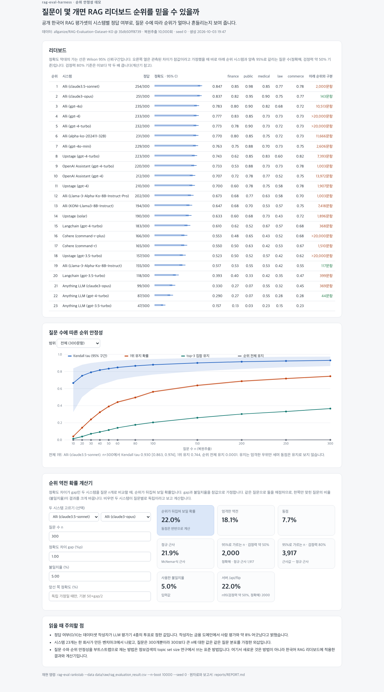

# 한국어 RAG 리더보드 순위 안정성

[](https://github.com/parksungyun0411/rag-eval-harness/actions/workflows/ci.yml)  [](LICENSE)

골든셋 질문이 몇 개면 한국어 RAG 리더보드의 순위를 믿을 수 있는지 측정한 저장소입니다. 공개 데이터셋 [allganize/RAG-Evaluation-Dataset-KO](https://huggingface.co/datasets/allganize/RAG-Evaluation-Dataset-KO)에 담긴 RAG 시스템 23개의 질문 300개별 정답 여부를 그대로 쓰고, 질문 집합을 부트스트랩해 질문 수에 따라 순위가 얼마나 흔들리는지 계산했습니다. 결과는 리더보드·안정성 곡선·순위 역전 확률 계산기를 보여 주는 웹 화면으로도 확인할 수 있습니다.

리더보드 표의 숫자 차이만으로는 그 차이가 질문을 다시 뽑아도 유지될지 알 수 없습니다. 같은 질문으로 두 시스템을 채점하면 한쪽만 맞힌 질문이 몇 개인지(불일치율)가 순위의 흔들림을 결정하는데, 리더보드에는 이 값이 보이지 않습니다. 이 저장소는 그 값을 계산해 "이 두 시스템을 가르려면 질문이 몇 개 필요한가"에 답합니다.

질문 수와 순위 안정성의 관계를 부트스트랩으로 재는 방법은 정보검색 분야의 topic set size 연구에서 쓰이는 표준적인 방법입니다. 이 저장소가 새로 한 일은 방법이 아니라, 그 방법을 한국어 RAG 리더보드 데이터에 적용한 측정과, 질문 수·정확도 차이·불일치율로 역전 확률을 바로 계산하는 도구입니다.

저장소 이름(`rag-eval-harness`)은 이 실험이 쓰는 평가 하네스(지표·통계·검색 구성 요소)를 함께 담고 있어서 붙인 이름입니다.

## 구현 범위

- 데이터 로더: Hugging Face 데이터셋을 고정 리비전에서 받아 SHA-256을 확인하고, 시스템 × 질문 정답 행렬과 도메인 라벨로 변환(O/X가 아닌 값이 있으면 오류)
- 순위 안정성 분석: 질문 수 n별 부트스트랩으로 전체 순위와의 Kendall tau, 1위 유지 확률, top-3·top-5 집합 유지 확률, 순위 전체 유지 확률과 구간
- 인접 순위 쌍 분석: 바로 이웃한 두 시스템을 양측 95%로 가르는 데 필요한 질문 수를 시뮬레이션·정확해·정규 근사로 각각 계산
- 해석적 교차 검증: 쌍별 차이의 정확한 분포(삼항 분포의 합)와 McNemar식 정규 근사를 시뮬레이션과 비교
- 도메인별 분석: 도메인(각 60문항) 1위와 1위가 될 확률, 도메인 순위와 전체 순위의 상관
- 순위 역전 확률 계산기: n, 정확도 차이, 불일치율(선택)로 역전 확률과 필요한 질문 수를 계산하는 Python 함수, FastAPI 엔드포인트, 같은 식의 JavaScript 구현
- 데모 화면: 리더보드, 안정성 곡선, 계산기를 보여 주는 정적 단일 페이지(`web/`). 서버 없이 정적 호스팅으로도 동작
- 평가 하네스: 랭킹 지표(hit@k·recall@k·MRR·nDCG·mAP), Wilson 구간·McNemar 검정, 실험 매트릭스 실행기, 교체 가능한 검색 구성 요소(Kiwi+BM25, dense, RRF, 리랭커), 실제 질의 대 합성 질의 골든셋 비교(보조 실험, 측정 전)

## 아키텍처


분석은 정답 행렬 하나에서 출발합니다. 부트스트랩 결과와 정확해·정규 근사는 같은 행렬에서 따로 계산하고 서로 비교합니다. `make eval` 한 번이 보고서(`reports/REPORT.md`), 표의 원자료 CSV, 그림, 웹 화면용 `web/data/results.json`을 함께 만듭니다. 다이어그램 원본은 [docs/diagrams/architecture.html](docs/diagrams/architecture.html)입니다.

## 기술 스택

| 영역 | 기술 |
|---|---|
| 언어 |    |
| 계산·통계 |   |
| 시각화 |   |
| 데모 |  |
| 검색(하네스) |    |
| 코드 품질 |    |

## 실행 방법

필요한 도구는 Python 3.12와 uv입니다. 대표 실험은 API 키 없이 실행됩니다.

```bash
uv sync --extra kiwi --extra demo
make test
make lint

make collect    # 고정 리비전 CSV 다운로드 + SHA-256 확인 → data/raw/ (커밋하지 않음)
make index      # 시스템 × 질문 정답 행렬 → reports/rank_stability/correctness_matrix.csv
make eval       # 부트스트랩 10,000회(seed 0) → reports/REPORT.md, reports/rank_stability/, web/data/results.json
make serve      # http://localhost:8000 — 데모 화면과 API
```

`web/`은 `data/results.json`만 읽는 정적 페이지라서 서버 없이 정적 호스팅(GitHub Pages 등)에 그대로 올릴 수 있습니다. FastAPI 서버로 띄우면 계산기 옆에 서버 정확해(`/api/flip`)도 함께 표시합니다.

| 엔드포인트 | 내용 |
|---|---|
| `GET /api/leaderboard` | 정확도, Wilson 95% 구간, 도메인별 정확도 |
| `GET /api/stability` | 전체·도메인별 안정성 곡선, 인접 쌍 분석 |
| `GET /api/flip?n=&gap=&discordance=&accuracy=` | 역전 확률(정확해·정규 근사), 95%로 가르는 데 필요한 n |

계산기는 라이브러리로도 씁니다.

```python
from rag_eval.rankstab import flip_probability

flip_probability(n=300, gap=0.01, discordance=0.05)
# p_flip, p_reverse, p_tie, p_flip_normal, n_95_exact, n_95_normal
```



## 평가

### 리더보드 순위 안정성 (측정 완료)

데이터는 `allganize/RAG-Evaluation-Dataset-KO` 리비전 `35db50ff`의 시스템 23개 × 질문 300개(금융·공공·의료·법률·커머스 각 60개)입니다. 질문 집합을 복원추출 10,000회(seed 0) 재추출했습니다. 재현 정보와 전체 표는 [reports/REPORT.md](reports/REPORT.md)에 있습니다.

질문 수에 따른 전체 순위 안정성 (`reports/rank_stability/curve_overall.csv`). tau 구간은 반복값의 2.5~97.5 백분위, 1위 유지 구간은 Wilson 95%입니다. 유지는 엄격한 우위만 세며 동점은 유지로 보지 않습니다.

| 질문 수 n | Kendall tau-b [95%] | 1위 유지 확률 [95%] | top-3 집합 유지 | 순위 전체 유지 |
|---:|---|---|---:|---:|
| 30 | 0.791 [0.583, 0.899] | 0.240 [0.231, 0.248] | 0.072 | 0.000 |
| 50 | 0.833 [0.674, 0.922] | 0.391 [0.382, 0.401] | 0.116 | 0.000 |
| 100 | 0.879 [0.764, 0.946] | 0.562 [0.553, 0.572] | 0.204 | 0.000 |
| 300 | 0.930 [0.863, 0.974] | 0.744 [0.736, 0.753] | 0.366 | 0.000 |

- 전체 300문항 기준 1위(Alli claude3.5-sonnet, 254/300)와 2위(Alli claude3-opus, 251/300)의 차이는 3문항입니다. 같은 크기(300문항)의 평가셋을 다시 뽑으면 1위가 유지되는 비율은 0.744 [0.736, 0.753]입니다 (`reports/rank_stability/curve_overall.csv`, n = 300).
- 두 시스템 중 한쪽만 맞힌 질문은 15개(불일치율 0.050)입니다. 이 차이를 양측 95%로 가르려면 같은 질문 분포에서 정확해 기준 2,000문항, 정규 근사 기준 1,917문항이 필요합니다. 300을 넘는 값은 외삽입니다 (`reports/rank_stability/adjacent_pairs.csv`, 1-2위 쌍).
- 바로 이웃한 순위 쌍 22개 중 300문항 안에서 정확해 기준으로 갈리는 쌍은 3개입니다(2-3위 143문항, 19-20위 117문항, 22-23위 44문항). 나머지 19개 쌍은 300문항으로 가를 수 없습니다 (`reports/rank_stability/adjacent_pairs.csv`).
- 23개 시스템의 순위 전체가 유지된 경우는 n = 300에서도 10,000회 중 1회였습니다 (`reports/rank_stability/curve_overall.csv`, `order_held`).

시뮬레이션과 해석해 비교 (`reports/rank_stability/approx_check.csv`, 인접 쌍 22개 × n 12개 = 264개 지점):

| 비교 | 최대 절대 차 | 평균 절대 차 | 차 > 0.05 지점 |
|---|---:|---:|---:|
| 시뮬레이션 − 정확해 | 0.016 | 0.003 | 0 |
| 정규 근사 − 정확해 | 0.062 | 0.002 | 1 |

정규 근사가 크게 어긋난 지점은 질문 수가 가장 작고(n = 10) 불일치율이 가장 낮은(0.050) 1-2위 쌍이었습니다(정확해 0.223, 정규 근사 0.286). 나머지 지점에서는 정규 근사도 정확해와 0.05 안에서 맞았습니다.

도메인별(각 60문항) 1위와 1위가 될 확률 (`reports/rank_stability/domain_rank_corr.csv`, `reports/rank_stability/domain_best_share.csv`, n = 60 복원추출):

| 도메인 | 도메인 1위 | 정확도 | 1위 확률 상위 2 | 전체 순위와 Kendall tau |
|---|---|---:|---|---:|
| finance | Alli (claude3.5-sonnet) | 0.850 | 0.68 · Alli (gpt-4) 0.14 | 0.818 |
| public | Alli (claude3.5-sonnet) | 0.983 | 0.92 · Alli (claude3-opus) 0.06 | 0.904 |
| medical | Alli (claude3-opus) | 0.900 | 0.78 · Alli (claude3.5-sonnet) 0.10 | 0.674 |
| law | Alli (claude3.5-sonnet) | 0.767 | 0.39 · OpenAI Assistant (gpt-4-turbo) 0.28 | 0.831 |
| commerce | Upstage (gpt-4-turbo) | 0.817 | 0.53 · Alli (claude3.5-sonnet) 0.24 | 0.679 |

도메인 1위는 다섯 도메인 중 세 곳에서 전체 1위와 같고, 의료와 커머스에서 다릅니다. 법률(0.39)과 커머스(0.53)는 60문항을 다시 뽑았을 때 같은 시스템이 1위가 될 확률이 절반 안팎이라, 도메인 1위가 바뀐다고 말할 근거로는 약합니다.

### 실제 질의 대 합성 질의 골든셋 (보조 실험, 측정 전)

측정 전 — `make golden-eval` 실행 후 자동 생성

같은 검색 설정들을 실제 사용자 질의 골든셋과 LLM 합성 질의 골든셋으로 각각 측정해 점수 차와 설정 순위의 상관을 계산하는 실험입니다. 데이터·색인·검색은 소비 프로젝트(`CONSUMER_DIR`)가 맡고, 합성 질의와 답변 판정에는 LLM 키가 필요합니다.

| 지표 | 평균 gap(합성 − 실제) | Kendall tau-b | Spearman rho | 최고 설정(실제) | 최고 설정(합성) |
|---|---:|---:|---:|---|---|
| hit@10 | | | | | |
| recall@10 | | | | | |
| MRR | | | | | |
| nDCG@10 | | | | | |

## 프로젝트 구조

```text
rag-eval-harness/
├── src/rag_eval/
│   ├── rankstab.py               순위 안정성: 부트스트랩, 정확해, 정규 근사, 역전 확률 계산기
│   ├── leaderboard_experiment.py 대표 실험 실행·보고서·웹 데이터 생성
│   ├── datasets/allganize_ko.py  데이터셋 다운로드(고정 리비전·SHA-256)·정답 행렬
│   ├── demo/app.py               FastAPI 데모 서버
│   ├── metrics.py · stats.py     랭킹 지표, Wilson·McNemar·순위 상관
│   ├── matrix.py · stability.py  실험 매트릭스 실행기, 검색 설정 순위 안정성
│   ├── retrieval/                BM25·Kiwi, dense, RRF·리랭커, 설정 → 검색기
│   ├── golden.py · synth.py · judge.py · llm.py   골든셋 비교(보조 실험)
│   ├── report.py                 보조 실험 보고서
│   └── cli.py                    rag-eval 명령
├── web/                          정적 데모 화면(index.html, app.js, flip.js, data/results.json)
├── reports/                      REPORT.md, rank_stability/ CSV·그림
├── configs/                      검색 설정 매트릭스 예시
├── docs/                         아키텍처 다이어그램(HTML 원본, PNG), 데모 스크린숏
└── tests/                        해석해·손계산 테스트, 합성 픽스처, API·JS 일치 테스트
```

## 구현하면서 신경 쓴 점

- 데이터를 쓰기 전에 데이터셋 카드와 파일을 대조했습니다. 23개 `*_ox` 열의 도메인별 정답 수가 카드의 리더보드 표와 모두 일치했고, 결측값은 없었습니다. 카드와 이름이 다른 열이 하나(`alli_Llama-3-Ko-8B-Finance-Evol` ↔ 카드의 "Alli (Llama-3-Alpha-Ko-8B-Instruct-Pro)") 있어, 정답 수가 도메인별로 모두 같은 것을 확인하고 카드 표기로 맞췄습니다.
- 원본 CSV는 저장소에 넣지 않았습니다. MIT 라이선스라 넣을 수는 있지만 각 시스템의 답변 전문이 들어 있어 약 5.7MB이고, 분석에는 정답 여부만 필요합니다. 고정 리비전에서 받아 SHA-256을 확인하는 스크립트를 두고, 분석에 쓰는 0/1 행렬(파생 자료)만 `reports/`에 커밋했습니다.
- 부트스트랩 결과를 정확해로 검증했습니다. 복원추출에서 두 시스템 차이의 합은 질문별 차이(+1, 0, -1)의 경험 분포를 따르는 삼항 분포의 합이므로 정확히 계산할 수 있습니다. 시뮬레이션과 정확해의 차이는 몬테카를로 오차뿐이어야 하고, 실제로 264개 지점에서 최대 0.016이었습니다.
- "필요한 질문 수"는 "그 n부터 계속 기준을 넘는 최소 n"으로 정의했습니다. 짝수 n에서는 동점 확률 때문에 바로 앞 홀수 n보다 우위 확률이 낮아질 수 있어, 처음 기준을 넘는 n을 답으로 하면 그 다음 n에서 다시 기준 아래로 떨어지는 경우가 생깁니다. 홀수·짝수를 따로 탐색하고, 전수 탐색 결과와 같은지 테스트로 확인합니다.
- 동점은 유지로 세지 않았습니다. 정확도가 1문항 단위로 갈리는 데이터라 재추출에서 동점이 자주 나옵니다. 동점을 유지로 세면 안정성이 실제보다 좋아 보이므로 1위·top-k·순위 전체 유지는 모두 엄격한 우위만 셉니다. 계산기의 역전 확률은 동점을 반반으로 나눈 값과 엄격한 역전·동점 확률을 따로 보여 줍니다.
- 계산기는 불일치율을 입력으로 받습니다. 같은 질문으로 두 시스템을 채점하면 분산은 정확도가 아니라 한쪽만 맞힌 질문의 비율에 달려 있습니다. 이 데이터의 인접 순위 쌍에서도 같은 플랫폼끼리인 11쌍은 불일치율이 0.050~0.200(중앙값 0.147), 다른 플랫폼끼리인 11쌍은 0.160~0.443(중앙값 0.297)이었습니다(`reports/rank_stability/adjacent_pairs.csv`, 플랫폼은 시스템 이름의 괄호 앞부분으로 구분). 불일치율을 모를 때만 두 시스템이 독립이라고 가정합니다.
- 웹 화면의 계산은 Python과 같은 식을 JavaScript로 옮겼고, Node가 있는 환경에서는 테스트가 두 구현의 결과를 비교합니다. 화면은 `results.json`만 읽어 정적 배포가 가능하고, 서버가 있으면 서버 결과를 함께 표시합니다.

## 한계

- 정답 여부(O/X)는 데이터셋 작성자의 판정입니다. 작성자는 LLM 평가기 4종의 투표로 정했고 금융 도메인에서 사람 평가와 약 8% 어긋났다고 밝혔습니다. 이 분석은 라벨 오류로 생기는 불확실성을 반영하지 않습니다.
- 시스템 23개는 한 회사(Allganize)가 만든 벤치마크에서 나왔고, 그중 10개는 같은 회사 플랫폼(Alli)의 생성 모델만 바꾼 변형입니다. 서로 비슷한 시스템이 많아 인접 쌍의 차이가 작게 나온 면이 있습니다. 다른 리더보드에 그대로 일반화할 수 없습니다.
- 질문이 300개뿐입니다. 300보다 큰 n에서 필요한 질문 수(예: 1-2위 쌍 2,000문항)는 지금의 질문 분포가 그대로 유지된다고 가정한 외삽이고, 그 범위에서 시뮬레이션으로 확인하지 않았습니다. 도메인별 분석은 60문항이라 더 불확실합니다.
- 부트스트랩은 질문이 같은 모집단에서 독립적으로 뽑혔다고 가정합니다. 질문은 도메인별 문서에서 작성자가 만든 것이라 이 가정이 정확히 맞지 않습니다.
- 방법은 새롭지 않습니다. 평가 주제 수와 순위 안정성의 관계는 정보검색의 topic set size 연구에서 오래 다뤄진 주제이고, 여기서 한 것은 그 방법을 한국어 RAG 리더보드에 적용하고 계산기로 만든 것입니다.
- 결과 자체도 예상 밖은 아닙니다. 차이가 몇 문항인 시스템을 300문항으로 가를 수 없다는 것은 표본 크기로 짐작할 수 있는 결론이며, 이 저장소가 더한 것은 그 정도를 쌍별로 수치화한 것입니다.
- 보조 실험(실제 질의 대 합성 질의 골든셋)은 아직 측정하지 않았습니다. 데모 화면은 로컬에서만 확인했고 배포하지 않았습니다.

## 라이선스

코드는 [MIT](LICENSE) 라이선스를 따릅니다. `reports/rank_stability/correctness_matrix.csv`와 `web/data/results.json`의 정답 여부는 [allganize/RAG-Evaluation-Dataset-KO](https://huggingface.co/datasets/allganize/RAG-Evaluation-Dataset-KO)(MIT)에서 파생한 자료입니다.
