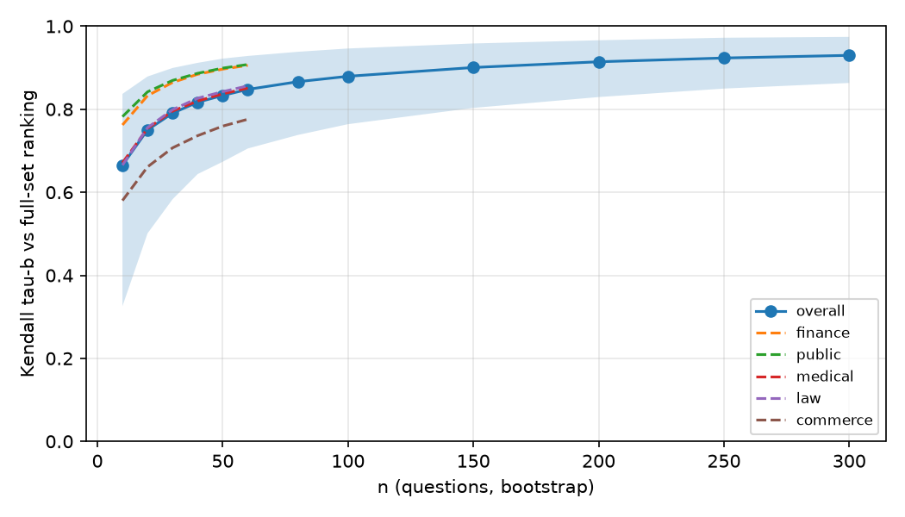
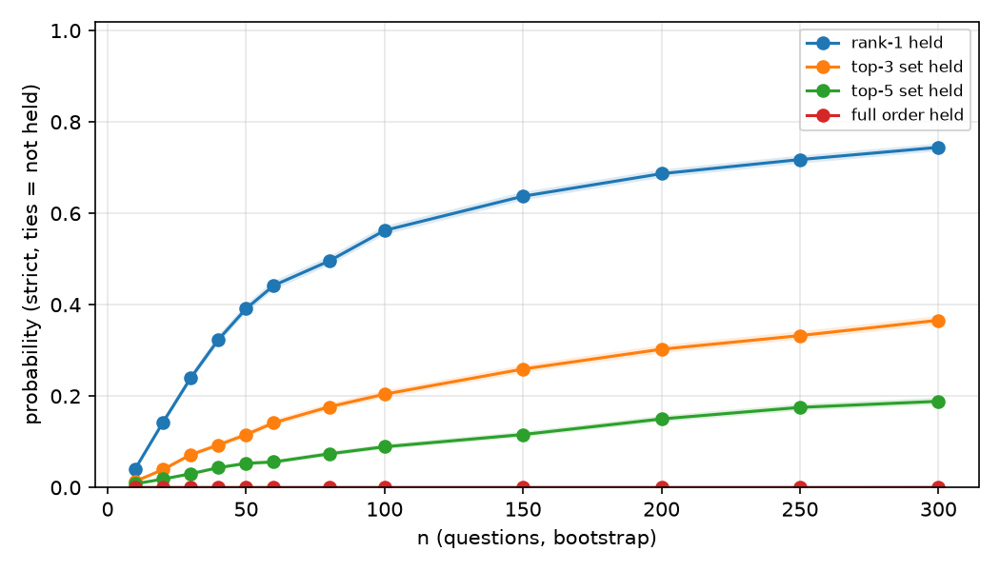
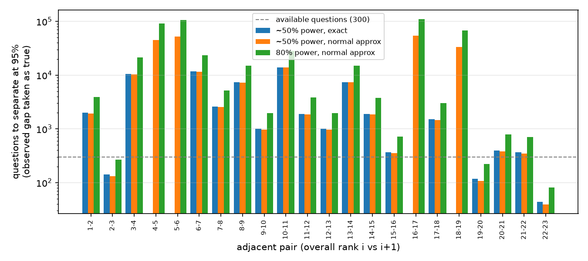
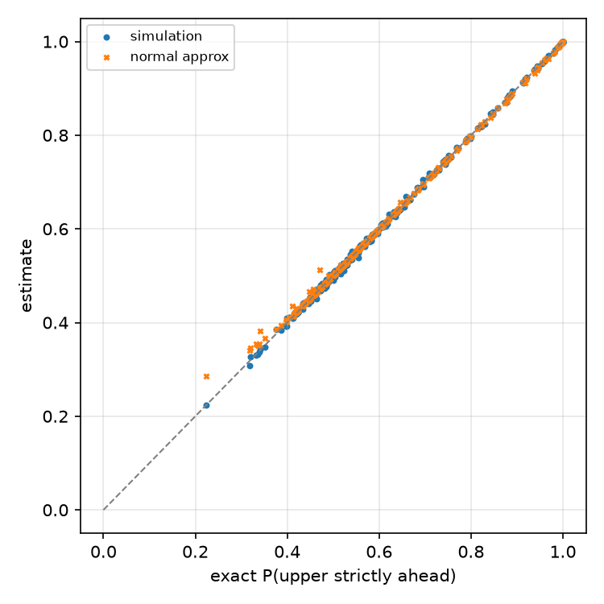
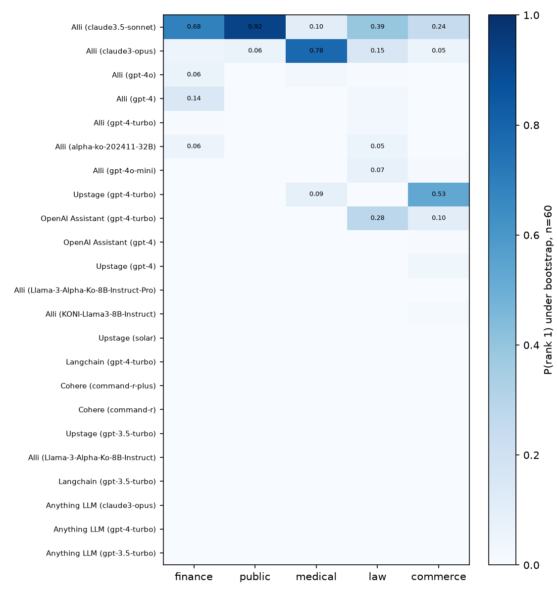

# 한국어 RAG 리더보드 순위 안정성 — 실험 보고서

생성: 2026-10-03 19:47 · `rag_eval.leaderboard_experiment` 가 자동 생성 (숫자를 손으로 적지 않음)

## 재현 정보

| 항목 | 값 |
|---|---|
| 데이터셋 | `allganize/RAG-Evaluation-Dataset-KO` (Hugging Face, MIT) |
| 리비전 | `35db50ff8739d78b11ee68b6f4ef04a95862a504` |
| 파일 · SHA-256 | `rag_evaluation_result.csv` · `b78fd2bc6b5fd7d36d9be9e23db6fe43677de5a9f6431a7b2826c03992938049` |
| 규모 | 시스템 23개 × 질문 300건 (도메인 5개 × 60건) |
| 정답 라벨 | 데이터셋의 `*_ox` 열 (작성자가 LLM 평가기 4종 투표로 판정) |
| 추출 | 복원추출(부트스트랩) 10000회, seed 0 (도메인별은 seed+1…+5) |
| n 격자 | 전체 [10, 20, 30, 40, 50, 60, 80, 100, 150, 200, 250, 300], 도메인 [10, 20, 30, 40, 50, 60] |
| 명령 | `rag-eval rankstab --data data/raw/rag_evaluation_result.csv --n-boot 10000 --seed 0` |

## 1. 리더보드 (전체 300문항)

정확도 옆 구간은 Wilson 95% 신뢰구간입니다. 원자료: `rank_stability/leaderboard.csv`

| 순위 | 시스템 | 정답 | 정확도 | 95% CI | finance | public | medical | law | commerce |
|---|---|---|---|---|---|---|---|---|---|
| 1 | Alli (claude3.5-sonnet) | 254/300 | 0.847 | [0.802, 0.883] | 0.85 | 0.98 | 0.85 | 0.77 | 0.78 |
| 2 | Alli (claude3-opus) | 251/300 | 0.837 | [0.791, 0.874] | 0.82 | 0.95 | 0.90 | 0.75 | 0.77 |
| 3 | Alli (gpt-4o) | 235/300 | 0.783 | [0.733, 0.826] | 0.80 | 0.90 | 0.82 | 0.68 | 0.72 |
| 4 | Alli (gpt-4) | 233/300 | 0.777 | [0.726, 0.820] | 0.83 | 0.85 | 0.73 | 0.73 | 0.73 |
| 5 | Alli (gpt-4-turbo) | 232/300 | 0.773 | [0.723, 0.817] | 0.78 | 0.90 | 0.73 | 0.72 | 0.73 |
| 6 | Alli (alpha-ko-202411-32B) | 231/300 | 0.770 | [0.719, 0.814] | 0.80 | 0.85 | 0.75 | 0.72 | 0.73 |
| 7 | Alli (gpt-4o-mini) | 229/300 | 0.763 | [0.712, 0.808] | 0.75 | 0.88 | 0.70 | 0.73 | 0.75 |
| 8 | Upstage (gpt-4-turbo) | 223/300 | 0.743 | [0.691, 0.789] | 0.62 | 0.85 | 0.83 | 0.60 | 0.82 |
| 9 | OpenAI Assistant (gpt-4-turbo) | 220/300 | 0.733 | [0.681, 0.780] | 0.53 | 0.88 | 0.73 | 0.73 | 0.78 |
| 10 | OpenAI Assistant (gpt-4) | 212/300 | 0.707 | [0.653, 0.755] | 0.72 | 0.78 | 0.77 | 0.52 | 0.75 |
| 11 | Upstage (gpt-4) | 210/300 | 0.700 | [0.646, 0.749] | 0.60 | 0.78 | 0.75 | 0.58 | 0.78 |
| 12 | Alli (Llama-3-Alpha-Ko-8B-Instruct-Pro) | 202/300 | 0.673 | [0.618, 0.724] | 0.68 | 0.77 | 0.63 | 0.58 | 0.70 |
| 13 | Alli (KONI-Llama3-8B-Instruct) | 194/300 | 0.647 | [0.591, 0.699] | 0.68 | 0.70 | 0.53 | 0.57 | 0.75 |
| 14 | Upstage (solar) | 190/300 | 0.633 | [0.577, 0.686] | 0.60 | 0.68 | 0.73 | 0.43 | 0.72 |
| 15 | Langchain (gpt-4-turbo) | 183/300 | 0.610 | [0.554, 0.663] | 0.62 | 0.52 | 0.67 | 0.57 | 0.68 |
| 16 | Cohere (command-r-plus) | 166/300 | 0.553 | [0.497, 0.609] | 0.48 | 0.65 | 0.43 | 0.52 | 0.68 |
| 17 | Cohere (command-r) | 165/300 | 0.550 | [0.493, 0.605] | 0.50 | 0.63 | 0.42 | 0.53 | 0.67 |
| 18 | Upstage (gpt-3.5-turbo) | 157/300 | 0.523 | [0.467, 0.579] | 0.50 | 0.52 | 0.57 | 0.42 | 0.62 |
| 19 | Alli (Llama-3-Alpha-Ko-8B-Instruct) | 155/300 | 0.517 | [0.460, 0.573] | 0.53 | 0.55 | 0.53 | 0.42 | 0.55 |
| 20 | Langchain (gpt-3.5-turbo) | 118/300 | 0.393 | [0.340, 0.450] | 0.40 | 0.33 | 0.42 | 0.35 | 0.47 |
| 21 | Anything LLM (claude3-opus) | 99/300 | 0.330 | [0.279, 0.385] | 0.27 | 0.07 | 0.55 | 0.32 | 0.45 |
| 22 | Anything LLM (gpt-4-turbo) | 87/300 | 0.290 | [0.242, 0.344] | 0.27 | 0.07 | 0.55 | 0.28 | 0.28 |
| 23 | Anything LLM (gpt-3.5-turbo) | 47/300 | 0.157 | [0.120, 0.202] | 0.13 | 0.03 | 0.23 | 0.15 | 0.23 |

## 2. 질문 수에 따른 전체 순위 안정성

질문 n건을 10000회 복원추출해 매긴 순위를 300문항 순위와 비교했습니다. tau 구간은 반복값의 2.5~97.5 백분위입니다. 확률 옆 구간은 반복 횟수에서 오는 몬테카를로 오차(Wilson 95%)일 뿐이며, 질문 표본 자체의 불확실성을 나타내지 않습니다. '유지'는 엄격한 우위만 셉니다(동점은 유지 아님). 원자료: `rank_stability/curve_overall.csv`

| n | Kendall tau-b [95%] | 1위 유지 [반복 오차 95%] | 1위 바뀜 | top-3 집합 유지 | top-5 집합 유지 | 순위 전체 유지 |
|---|---|---|---|---|---|---|
| 10 | 0.665 [0.326, 0.837] | 0.041 [0.037, 0.045] | 0.959 | 0.013 | 0.008 | 0.0000 |
| 20 | 0.750 [0.501, 0.879] | 0.143 [0.136, 0.150] | 0.857 | 0.039 | 0.018 | 0.0000 |
| 30 | 0.791 [0.583, 0.899] | 0.240 [0.231, 0.248] | 0.760 | 0.072 | 0.030 | 0.0000 |
| 40 | 0.817 [0.644, 0.912] | 0.324 [0.315, 0.333] | 0.676 | 0.093 | 0.043 | 0.0000 |
| 50 | 0.833 [0.674, 0.922] | 0.391 [0.382, 0.401] | 0.609 | 0.116 | 0.053 | 0.0000 |
| 60 | 0.848 [0.705, 0.928] | 0.442 [0.432, 0.452] | 0.558 | 0.142 | 0.056 | 0.0000 |
| 80 | 0.866 [0.738, 0.938] | 0.496 [0.486, 0.505] | 0.504 | 0.176 | 0.074 | 0.0000 |
| 100 | 0.879 [0.764, 0.946] | 0.562 [0.553, 0.572] | 0.438 | 0.204 | 0.089 | 0.0000 |
| 150 | 0.901 [0.803, 0.958] | 0.637 [0.628, 0.647] | 0.363 | 0.259 | 0.116 | 0.0000 |
| 200 | 0.914 [0.829, 0.966] | 0.687 [0.678, 0.696] | 0.313 | 0.303 | 0.150 | 0.0000 |
| 250 | 0.923 [0.850, 0.972] | 0.718 [0.709, 0.726] | 0.282 | 0.332 | 0.175 | 0.0000 |
| 300 | 0.930 [0.863, 0.974] | 0.744 [0.736, 0.753] | 0.256 | 0.366 | 0.189 | 0.0001 |

## 3. 인접 순위 쌍을 가르는 데 필요한 질문 수

전체 순위에서 바로 이웃한 두 시스템마다, 관측된 차이와 불일치율이 참값이라고 가정했을 때 P(위 시스템이 엄격히 앞섬) ≥ 0.975가 되는(양측 95%로 갈리는) 질문 수입니다. 이 기준은 δ√n/σ ≈ 1.96 인 지점이라 검정력 약 50%에 해당합니다(그 n으로 새로 평가하면 절반쯤만 유의하게 갈림). 검정력 80% 기준은 ((1.96 + 0.84)·σ/δ)² 정규 근사로 따로 적었습니다. '격자'는 시뮬레이션 격자에서 그 n부터 끝까지 기준을 넘는 첫 값, '정확해'는 삼항 분포로 계산한 값입니다(탐색 상한 20,000). 300을 넘는 값은 같은 질문 분포를 가정한 외삽입니다. '위만/아래만'은 300문항 중 한쪽만 맞힌 질문 수이고, McNemar p는 그 불일치 쌍에 대한 양측 정확 검정입니다. 원자료: `rank_stability/adjacent_pairs.csv`

| 순위 | 위 | 아래 | 정확도 차 | 불일치율 | 위만/아래만 | McNemar p | 검정력 50%: 격자(≤300) | 검정력 50%: 정확해 | 검정력 50%: 정규 근사 | 검정력 80%: 정규 근사 |
|---|---|---|---|---|---|---|---|---|---|---|
| 1-2 | Alli (claude3.5-sonnet) | Alli (claude3-opus) | 0.010 | 0.050 | 9/6 | 0.6072 | >300 | 2000 | 1917 | 3917 |
| 2-3 | Alli (claude3-opus) | Alli (gpt-4o) | 0.053 | 0.100 | 23/7 | 0.0052 | 200 | 143 | 131 | 268 |
| 3-4 | Alli (gpt-4o) | Alli (gpt-4) | 0.007 | 0.120 | 19/17 | 0.8679 | >300 | 10513 | 10368 | 21184 |
| 4-5 | Alli (gpt-4) | Alli (gpt-4-turbo) | 0.003 | 0.130 | 20/19 | 1.0000 | >300 | >20000 | 44941 | 91824 |
| 5-6 | Alli (gpt-4-turbo) | Alli (alpha-ko-202411-32B) | 0.003 | 0.150 | 23/22 | 1.0000 | >300 | >20000 | 51856 | 105952 |
| 6-7 | Alli (alpha-ko-202411-32B) | Alli (gpt-4o-mini) | 0.007 | 0.133 | 21/19 | 0.8746 | >300 | 11666 | 11521 | 23539 |
| 7-8 | Alli (gpt-4o-mini) | Upstage (gpt-4-turbo) | 0.020 | 0.267 | 43/37 | 0.5764 | >300 | 2606 | 2557 | 5225 |
| 8-9 | Upstage (gpt-4-turbo) | OpenAI Assistant (gpt-4-turbo) | 0.010 | 0.190 | 30/27 | 0.7914 | >300 | 7393 | 7295 | 14905 |
| 9-10 | OpenAI Assistant (gpt-4-turbo) | OpenAI Assistant (gpt-4) | 0.027 | 0.180 | 31/23 | 0.3409 | >300 | 1003 | 969 | 1979 |
| 10-11 | OpenAI Assistant (gpt-4) | Upstage (gpt-4) | 0.007 | 0.160 | 25/23 | 0.8854 | >300 | 13972 | 13825 | 28248 |
| 11-12 | Upstage (gpt-4) | Alli (Llama-3-Alpha-Ko-8B-Instruct-Pro) | 0.027 | 0.347 | 56/48 | 0.4926 | >300 | 1907 | 1869 | 3818 |
| 12-13 | Alli (Llama-3-Alpha-Ko-8B-Instruct-Pro) | Alli (KONI-Llama3-8B-Instruct) | 0.027 | 0.180 | 31/23 | 0.3409 | >300 | 1003 | 969 | 1979 |
| 13-14 | Alli (KONI-Llama3-8B-Instruct) | Upstage (solar) | 0.013 | 0.340 | 53/49 | 0.7666 | >300 | 7418 | 7343 | 15003 |
| 14-15 | Upstage (solar) | Langchain (gpt-4-turbo) | 0.023 | 0.263 | 43/36 | 0.4999 | >300 | 1896 | 1854 | 3788 |
| 15-16 | Langchain (gpt-4-turbo) | Cohere (command-r-plus) | 0.057 | 0.297 | 53/36 | 0.0893 | >300 | 368 | 351 | 717 |
| 16-17 | Cohere (command-r-plus) | Cohere (command-r) | 0.003 | 0.157 | 24/23 | 1.0000 | >300 | >20000 | 54161 | 110661 |
| 17-18 | Cohere (command-r) | Upstage (gpt-3.5-turbo) | 0.027 | 0.273 | 45/37 | 0.4397 | >300 | 1510 | 1473 | 3009 |
| 18-19 | Upstage (gpt-3.5-turbo) | Alli (Llama-3-Alpha-Ko-8B-Instruct) | 0.007 | 0.387 | 59/57 | 0.9261 | >300 | >20000 | 33417 | 68277 |
| 19-20 | Alli (Llama-3-Alpha-Ko-8B-Instruct) | Langchain (gpt-3.5-turbo) | 0.123 | 0.443 | 85/48 | 0.0017 | 150 | 117 | 108 | 221 |
| 20-21 | Langchain (gpt-3.5-turbo) | Anything LLM (claude3-opus) | 0.063 | 0.403 | 70/51 | 0.1014 | >300 | 399 | 382 | 781 |
| 21-22 | Anything LLM (claude3-opus) | Anything LLM (gpt-4-turbo) | 0.040 | 0.147 | 28/16 | 0.0961 | >300 | 369 | 348 | 712 |
| 22-23 | Anything LLM (gpt-4-turbo) | Anything LLM (gpt-3.5-turbo) | 0.133 | 0.200 | 50/10 | <0.0001 | 50 | 44 | 39 | 80 |

300문항 안에서 정확해 기준으로 갈리는 인접 쌍: 3/22

## 4. 시뮬레이션 · 정확해 · 정규 근사 비교

인접 쌍 22개 × n 12개 = 264개 지점의 P(위 시스템이 엄격히 앞섬)입니다. 복원추출 시뮬레이션은 이론상 정확해와 같은 분포를 따르므로 차이는 몬테카를로 오차입니다. 원자료: `rank_stability/approx_check.csv`

| 비교 | 최대 절대 차 | 평균 절대 차 | 차 > 0.05 지점 수 |
|---|---|---|---|
| 시뮬레이션 − 정확해 | 0.016 | 0.003 | 0 |
| 정규 근사 − 정확해 | 0.062 | 0.002 | 1 |

정규 근사가 정확해와 가장 많이 어긋난 지점:

| 위 | 아래 | n | 정확해 | 시뮬레이션 | 정규 근사 |
|---|---|---|---|---|---|
| Alli (claude3.5-sonnet) | Alli (claude3-opus) | 10 | 0.223 | 0.224 | 0.286 |
| Alli (claude3-opus) | Alli (gpt-4o) | 10 | 0.470 | 0.469 | 0.513 |
| Alli (claude3.5-sonnet) | Alli (claude3-opus) | 20 | 0.341 | 0.343 | 0.382 |
| Alli (gpt-4o) | Alli (gpt-4) | 10 | 0.320 | 0.328 | 0.346 |
| Alli (claude3.5-sonnet) | Alli (claude3-opus) | 30 | 0.411 | 0.409 | 0.435 |
| Alli (gpt-4) | Alli (gpt-4-turbo) | 10 | 0.319 | 0.308 | 0.341 |
| Alli (alpha-ko-202411-32B) | Alli (gpt-4o-mini) | 10 | 0.332 | 0.331 | 0.354 |
| Anything LLM (claude3-opus) | Anything LLM (gpt-4-turbo) | 10 | 0.448 | 0.450 | 0.467 |

## 5. 도메인별 (각 60문항)

도메인 안에서의 1위와, 도메인 순위와 전체 순위의 Kendall tau입니다. '1위 확률'은 도메인 60문항을 복원추출했을 때 각 시스템이 1위가 되는 비율(공동 1위는 나눔)입니다. 원자료: `rank_stability/domain_rank_corr.csv`, `rank_stability/domain_best_share.csv`, `rank_stability/curve_domain.csv`

| 도메인 | 1위(동률 포함) | 1위 정확도 | 전체 순위와 tau | 1위 확률 상위 3 (n=60) | tau (n=60 재추출) |
|---|---|---|---|---|---|
| finance | Alli (claude3.5-sonnet) | 0.850 | 0.818 | Alli (claude3.5-sonnet) 0.68 · Alli (gpt-4) 0.14 · Alli (gpt-4o) 0.06 | 0.906 |
| public | Alli (claude3.5-sonnet) | 0.983 | 0.904 | Alli (claude3.5-sonnet) 0.92 · Alli (claude3-opus) 0.06 · Alli (gpt-4o) 0.00 | 0.908 |
| medical | Alli (claude3-opus) | 0.900 | 0.674 | Alli (claude3-opus) 0.78 · Alli (claude3.5-sonnet) 0.10 · Upstage (gpt-4-turbo) 0.09 | 0.851 |
| law | Alli (claude3.5-sonnet) | 0.767 | 0.831 | Alli (claude3.5-sonnet) 0.39 · OpenAI Assistant (gpt-4-turbo) 0.28 · Alli (claude3-opus) 0.15 | 0.856 |
| commerce | Upstage (gpt-4-turbo) | 0.817 | 0.679 | Upstage (gpt-4-turbo) 0.53 · Alli (claude3.5-sonnet) 0.24 · OpenAI Assistant (gpt-4-turbo) 0.10 | 0.776 |

